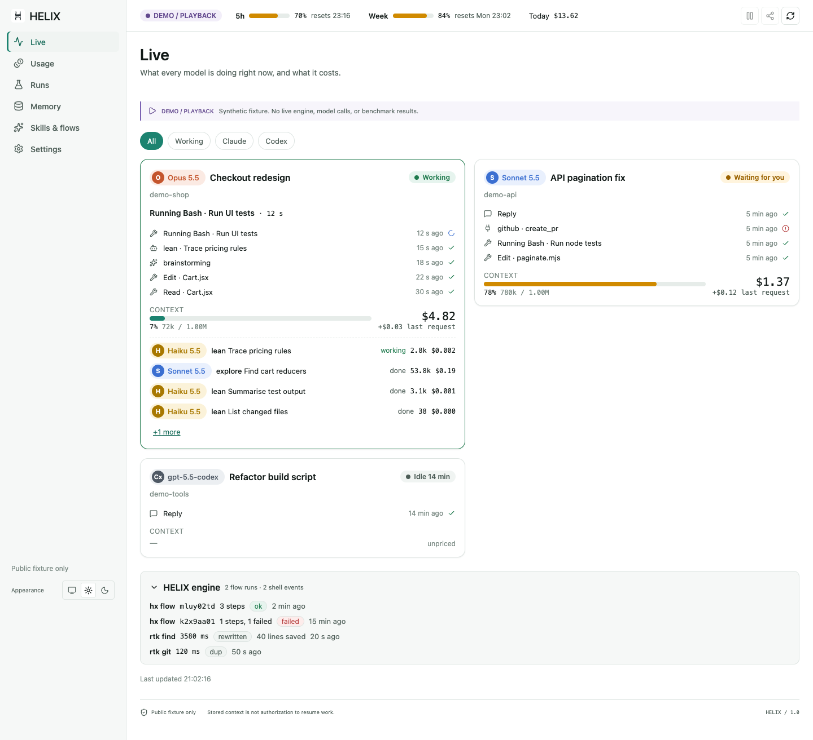

# HELIX 1.0 — Claude


[Buy me a coffee](https://buymeacoffee.com/superhelix7)

HELIX 1.0 — Claude is the Claude Code edition of the HELIX engine. It keeps the HELIX ideas: exact originals stay out of repeated context, compact evidence is returned in their place, and mechanical steps run without asking a model to decide them again. On top of those it adds a toolchain for Claude Code agents and a rebuilt desktop app that shows what every model is doing and what it costs. It does not lower reasoning effort, force terse thinking, or promise unchanged task quality, and the evidence below includes where it lost.



The screenshots use public synthetic fixtures, not live data.

## Current Evidence

These are the 50 frozen new50 SWE-bench tasks, graded with the official SWE-bench grader (swebench 5.0.2). Both lanes ran Claude Opus 5.5 at high effort with stock Claude Code defaults, isolated settings and identical task prompts. Every task image was pinned by id, and its gold patch was checked before the lanes ran.

| Measure | vanilla-continuous | HELIX helixy |
| --- | ---: | ---: |
| Officially resolved | 45 / 50 | 43 / 50 |
| Tokens (per request, deduplicated) | 129,381,259 | 3,370,242 |
| Cost (Claude Code reported) | $38.23 | $7.95 |
| Model calls | 467 | 349 |
| Tool calls | 422 | 298 |
| Context p50 / p90 / max | 258k / 499k / 541k | 8k / 15k / 21k |
| Failures | 1 (60-minute time limit) | 0 |
| Compactions | 0 | 0 |

HELIX used **97.4% fewer tokens** and cost **79.2% less**, and resolved **two fewer** tasks (95.6% of vanilla's). Both lanes resolved the same 42 tasks. Vanilla alone resolved 3, HELIX alone resolved 1 (where vanilla hit the time limit), and neither resolved 4. In HELIX's two analysed misses, the fix was right for the case the issue showed but was applied too narrowly.

**How the numbers are counted, and a correction.** vanilla-continuous resumes one Claude Code session across all 50 tasks. A resumed `claude -p` process reports cost and `modelUsage` *cumulative* for the whole session, so per-task cost here is the delta from the previous task. Tokens are counted from per-request usage, deduplicated by message id. An earlier internal draft summed those cumulative totals and overstated vanilla at $843.97 and 2.53B tokens. A public review of a sibling branch's benchmark math prompted the audit that found the error. The harness now computes deltas, and a regression test covers it.

**What this comparison is not.** One unreset session across 50 unrelated tasks is a long-session scenario: it grows context (vanilla's p90 reached 499k). Prompt caching also makes it cheaper per task than one session per task. A fresh-session vanilla baseline, and a HELIX lane that runs the same continuous workflow, have not been run yet; they are next. The costs are API-equivalent figures. The runs used a subscription with extra usage disabled, and a usage-gated driver paused the run once for the 5-hour window. HELIX never rewrites earlier turns, so prompt-cache prefixes stay valid.

**What did not work.** A "contract pass" lane (helixc), which checks callers and helper assumptions before editing, recovered 0 of 4 graded misses. Its agent never invoked the pass. Agents ignore optional tools that are only suggested in the prompt, so a pass like this has to be enforced by the harness. helixc is not part of this edition.

Full aggregate: [benchmarks/new50-full-helixy-vs-vanilla-20261024.md](benchmarks/new50-full-helixy-vs-vanilla-20261024.md).

## What this edition adds

**The app** (`npm run desktop`): Live, Usage, Runs, Memory, Skills & flows and Settings, in light and dark, usable at phone width.
- **Live:** each Claude or Codex session with its model, current step or tool, last actions, context fill, cost ticker and subagents.
- **Usage:** tokens and cost per model, session or project, the cache-hit share, and your plan's 5-hour and weekly limits with reset times. Prices come from Anthropic's published rates; reported costs are preferred where they exist.
- **Share snapshot:** saves a static, privacy-filtered HTML report you can open on a phone, for example while you follow a session over Remote Control.
- **Privacy:** no local paths, emails or prompts are shown by default.

**The Claude toolchain** (`claude/`, installed with `claude/install.sh`):
- **`hx`:** runs a whole tool plan in one Bash call.
  - Steps: read (including `FILE:SYMBOL`), grep, glob, ls, edit, write, test, sh, fetch, search, browse and memory.
  - Skills: `skill NAME`, plus `hx skill list` across personal, plugin and project skills.
  - Model switch: `haiku` / `sonnet` / `opus` subagent steps with `check`, which return only a short report.
  - Control: parallel steps, `when` / `unless` branches on results, `{{name}}` refs, background `bg` / `wait`, Haiku `digest`, `include FLOW`, and `hx resume` from a failed step.
  - Errors: a failed test shows the code at the failure, and a missed edit shows the closest lines.
- **Workflow:** the agent plans its tool calls before starting, and every call runs up to the next result it must read. Thinking and visual/UI design are owned by Opus and implemented by Sonnet: `include design 'GOAL' 'SPEC' 'CHECK'` runs an Opus spec, a Sonnet build with a check, and an Opus review.
- **Hook adapter:**
  - Archives every session losslessly.
  - Re-injects a memory capsule after a clear, a compaction or a resume.
  - Offloads oversized tool output.
  - Runs a context guard.
- **Clear-and-continue for continuous work:** state is saved to memory before a clear, and a fresh context resumes from the capsule. Details are fetched with `hmem` / `hx recall` lookups, which make no model call. Under Remote Control, where the desktop app refuses to clear a session, a continue marker hands the work to a fresh session.
- **`lean-run`:** cheap headless subagents.
- **`lean95v` output style:** dense calls, plus the rules above.

## Run Locally

The engine requirements are the same as for HELIX 1.0: Node.js 22.19 or newer, npm and Git. Python 3 is used by the Claude hook adapter.

```sh
git clone https://github.com/SuperHelix77/HELIX-1.0-Claude.git
cd HELIX-1.0-Claude
npm ci
npm run build
node bin/helix.mjs start
npm run desktop
```

To install the Claude toolchain (it backs up anything it would replace, and prints the hooks to merge into `~/.claude/settings.json` instead of editing them):

```sh
claude/install.sh
```

See [claude/README.md](claude/README.md) for each tool and for uninstalling.

## Build, test, inspect

```sh
npm test
npm run check
npm run build
npm run test:ui
npm run privacy
```

## What comes next

- A fresh-session vanilla baseline and the continuous-workflow HELIX lane (`helixy-cont`) on the same 50 tasks.
- Enforcing a contract pass in the harness (a pre-edit hook), instead of suggesting it.
- Seamless clear-and-continue inside a single Remote Control session.

## Acknowledgments, licensing and support

The license is in [LICENSE](LICENSE) and third-party notices are in [THIRD_PARTY_NOTICES.md](THIRD_PARTY_NOTICES.md). The double-strand mark comes from [Helix-Harness](https://github.com/SuperHelix77/Helix-Harness); see [visual credits](docs/ASSETS.md). The engine, its evidence model and its limits are described in the [HELIX 1.0 README](https://github.com/SuperHelix77/HELIX-1.0#readme).
